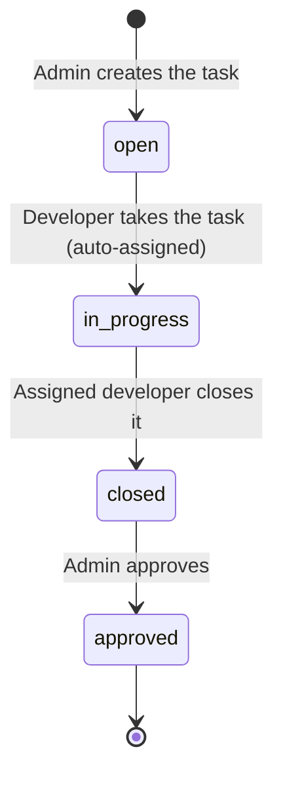

<div align="center">

<h1>Smart Task Manager</h1>

<p>A full-stack task management app with role-based access control, built with <b>FastAPI</b>, <b>React</b> and <b>TypeScript</b>.</p>

<p>
  
  
  
  
  
  
</p>

</div>

Admins create projects and tasks and manage users. Developers take open tasks themselves, update their progress and add comments. Admins then approve completed work.

Built as the final assignment (seminar) of my Practical Software Engineering studies.

> The user interface is in **Hebrew (RTL)**.

## Contents

- [Screenshots](#-screenshots)
- [Features](#-features)
- [Task Workflow](#-task-workflow)
- [Tech Stack](#-tech-stack)
- [Architecture](#-architecture)
- [Getting Started](#-getting-started)
- [Running Tests](#-running-tests)
- [Data Analysis](#-data-analysis)
- [Known Limitations & Future Improvements](#-known-limitations--future-improvements)
- [What I Learned](#-what-i-learned)
- [Author](#-author)

## 📸 Screenshots

<p align="center">
  
  <br />
  <sub>Login</sub>
</p>

<table>
  <tr>
    <td align="center" width="50%">
      
      <br />
      <sub>Developer View</sub>
    </td>
    <td align="center" width="50%">
      
      <br />
      <sub>Admin View & Task Management</sub>
    </td>
  </tr>
</table>

## ✨ Features

### Admin
- Create and delete projects
- Create and delete tasks (title, description, priority, due date, project)
- Change the status of any task
- Approve tasks that have been closed
- Manage users: add, edit name, email and role, delete developers

### Developer
- View all tasks, or switch to "My tasks" to see only the ones assigned to them
- Take an open task. Setting it to `in_progress` assigns it to the developer automatically
- Close tasks assigned to them
- View projects (read-only)

### Everyone
- Register and log in with JWT authentication (tokens expire after 60 minutes)
- Passwords hashed with bcrypt
- Search tasks by title and filter by status and priority
- Add and read comments on tasks

## 🔄 Task Workflow



- A developer can't take a task that's already assigned to someone else, and can only close their own tasks.
- Developers can't edit a task's title, description, priority, due date or approval. The API returns `403` if they try.
- Admins can set any status at any time.
- `approved` is a separate flag on a closed task, not a status value.

## 🧰 Tech Stack

| Layer | Technologies |
|---|---|
| Backend | Python 3.12, FastAPI, Pydantic v2, Uvicorn |
| Database | SQLite via `aiosqlite` (raw SQL, no ORM) |
| Auth | PyJWT (HS256), bcrypt |
| Frontend | React 19, TypeScript, Vite, React Router, Zustand, Axios |
| Testing | pytest, pytest-asyncio, httpx |
| Data analysis | Jupyter, pandas, matplotlib |

## 🧱 Architecture

```
├── backend/
│   ├── create_admin.py       # Seeds a demo admin user
│   ├── tests.py              # Unit and API tests
│   └── project/
│       ├── server.py         # FastAPI app, CORS, request logging
│       ├── schemas.py        # Pydantic request/response models
│       ├── api/              # Routers: users, projects, tasks, comments
│       ├── services/         # Business logic and permission checks
│       └── dal/              # Data access layer (SQL queries against SQLite)
├── frontend/
│   └── src/
│       ├── pages/            # Login, Register, Tasks, Projects, Users
│       ├── services/api.ts   # Axios client, attaches the JWT to each request
│       └── store/            # Zustand auth store
└── analysis.ipynb            # Data analysis notebook
```

The backend has three layers:
- **api**: handles HTTP and authentication.
- **services**: enforces business rules and role permissions.
- **dal**: the only layer that talks to the database.

## 🚀 Getting Started

### Prerequisites
- Python 3.12
- Node.js and npm

<details>
<summary><b>Backend</b></summary>

<br />

Run these commands from the `backend` folder:

```bash
cd backend
python -m venv venv
venv\Scripts\activate          # macOS/Linux: source venv/bin/activate
pip install fastapi uvicorn "pydantic[email]" aiosqlite bcrypt pyjwt
uvicorn project.server:app --reload
```

- API: http://127.0.0.1:8000
- Interactive API docs (Swagger): http://127.0.0.1:8000/docs
- The SQLite database (`backend/database.db`) is created automatically on first startup.

</details>

<details>
<summary><b>Create the demo admin</b></summary>

<br />

**Start the server at least once first**, so the database tables exist. Then, from the `backend` folder, run:

```bash
python create_admin.py
```

Demo credentials, **for local development only**:
- Email: `admin@admin.com`
- Password: `admin123`

</details>

<details>
<summary><b>Frontend</b></summary>

<br />

```bash
cd frontend
npm install
npm run dev
```

The app runs at http://localhost:5173. It expects the API at `http://127.0.0.1:8000`, which is set in `frontend/src/services/api.ts`.

</details>

## 🧪 Running Tests

From the `backend` folder:

```bash
pip install pytest pytest-asyncio httpx
pytest tests.py
```

The tests cover:
- JWT creation and validation, including expired and invalid tokens
- Password hashing
- Task API behavior: admin vs. developer permissions, filtering, and requests without a token

## 📊 Data Analysis

`analysis.ipynb` reads the SQLite database with pandas and charts task distribution by status and by assignee. It also calculates basic task statistics.

## 🚧 Known Limitations & Future Improvements

- **Secrets:** the JWT `SECRET_KEY` is defined in code. It should be loaded from environment variables.
- **Registration:** the register endpoint accepts a `role` field, so the backend should force new users to `developer`.
- **Task assignment:** admins can't assign tasks. Today, developers assign themselves by taking a task.
- **CORS:** all origins are allowed. This should be restricted to known origins.
- **Deployment:** the project currently runs locally only.

## 💡 What I Learned

TODO: written by me

## 👤 Author

**Meytal Mazal Harush** · [github.com/Meytal-Mazal-Harush](https://github.com/Meytal-Mazal-Harush)
